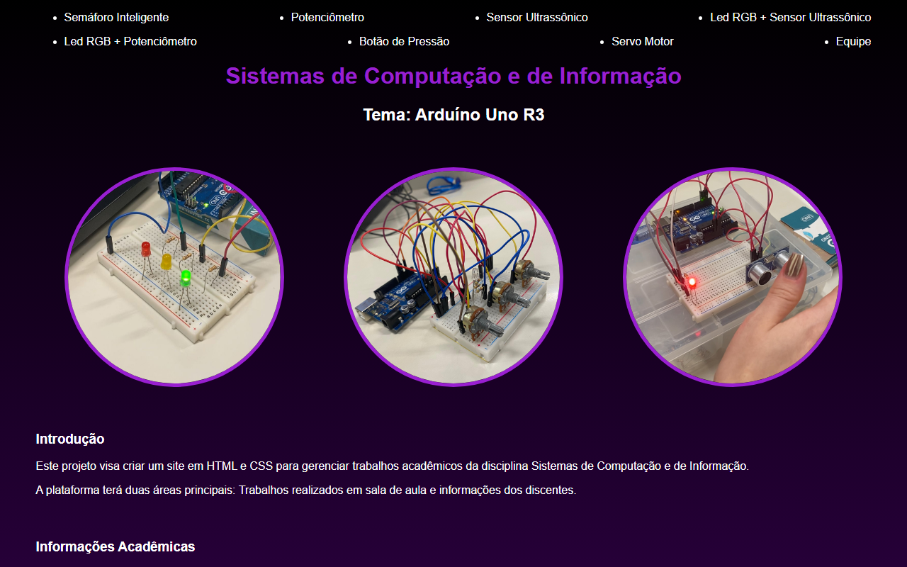
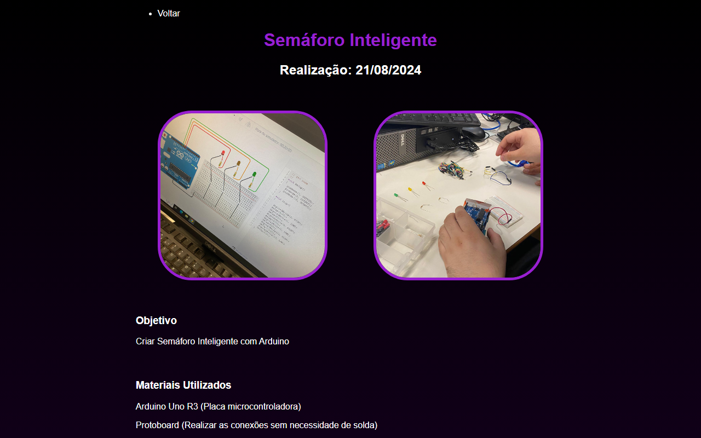

# Arduino Uno R3 · Portfólio de práticas

Site estático que documenta as aulas práticas de Arduino da disciplina **Sistemas de Computação e de Informação** (Sistemas de Informação, Anhanguera, 2024).
Cada página reúne o objetivo, os materiais, a montagem do circuito, a lógica do código, fotos e vídeo de uma prática.

**🔗 [Ver o site](https://opedroasa.github.io/site-trabalho-arduino/)**




## Práticas

| # | Prática | Data | O que faz |
|---|---|---|---|
| 1 | Semáforo inteligente | 21/08/2024 | Sequência de três LEDs controlada por pinos digitais |
| 2 | Potenciômetro | 28/08/2024 | Brilho do LED ajustado pelo potenciômetro |
| 3 | Sensor ultrassônico | 04/09/2024 | LED reage à aproximação de objetos |
| 4 | LED RGB + sensor ultrassônico | 11/09/2024 | Cor do LED muda conforme a distância |
| 5 | LED RGB + potenciômetros | 18/09/2024 | Três potenciômetros ajustam os canais R, G e B |
| 6 | Botão de pressão | 09/10/2024 | Botão liga e desliga o LED |
| 7 | Servo motor | 16/10/2024 | Rotação do servo acompanha a distância medida pelo sensor |



## Estrutura

```
index.html            página inicial, com o menu das práticas
trabalho1..7.html     uma página por prática (cada uma com o seu .css)
equipe.html           integrantes do grupo
img/  video/          fotos e vídeos das montagens
```

Feito só com HTML e CSS, sem framework e sem build. Publicado pelo GitHub Pages direto da branch `main`.

## Equipe

Pedro Antonio, Vinicius Umberto, Beatriz Andrade e Gabriel Nascimento. Orientação: prof. Rodrigo Morais.

**Minha parte:** desenvolvi o site inteiro (HTML, CSS, layout e publicação no GitHub Pages). Nas aulas, também montei os circuitos e programei a lógica das práticas no Arduino, junto com o grupo.
